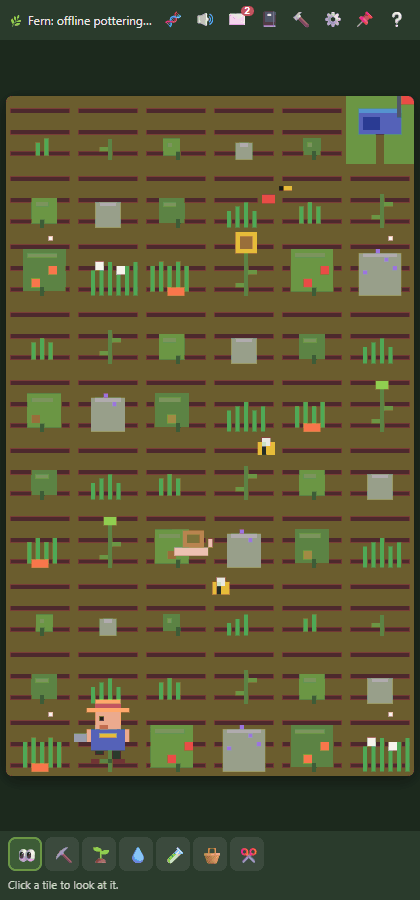
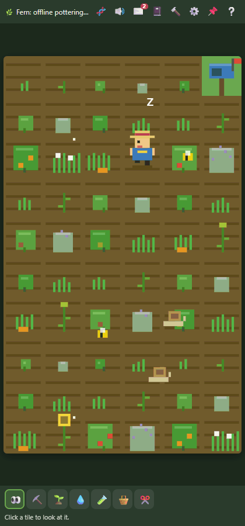
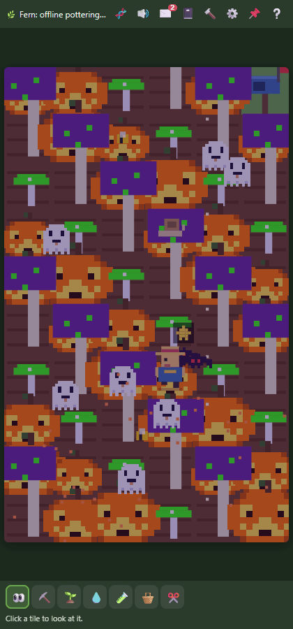
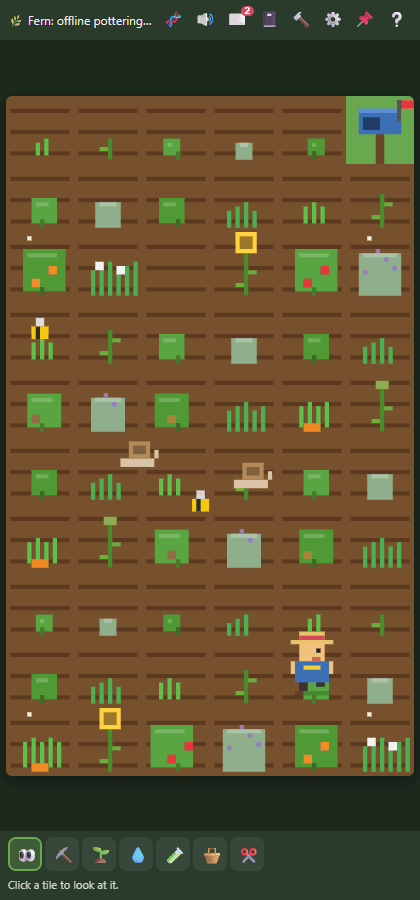
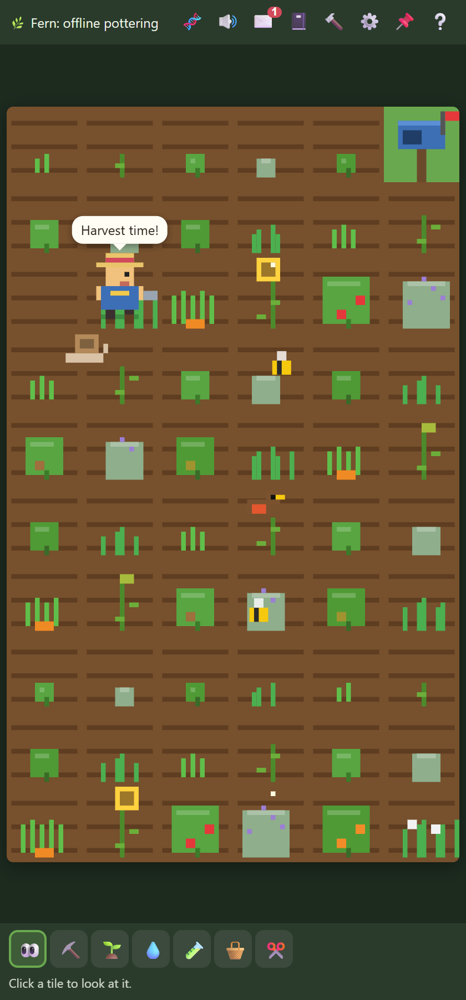
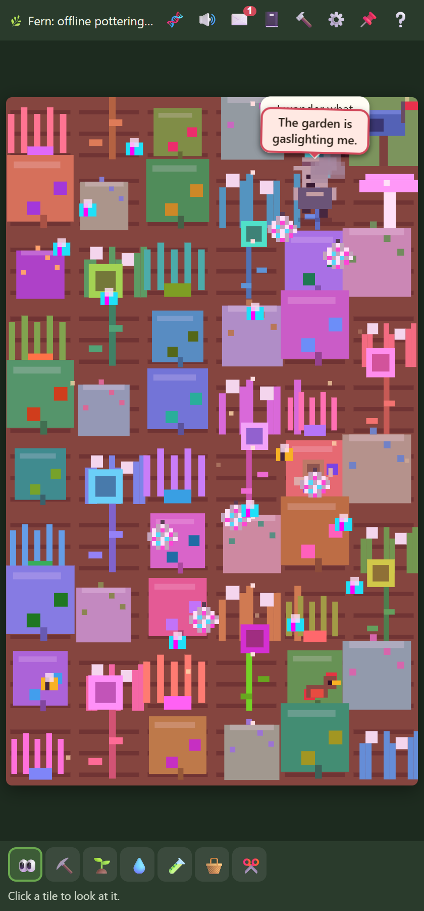
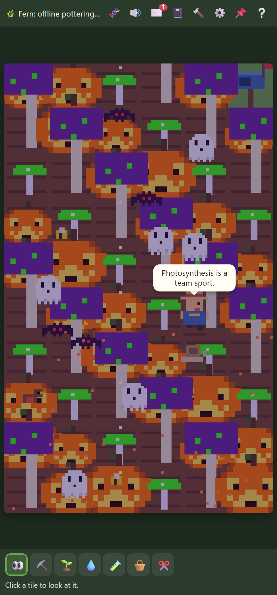
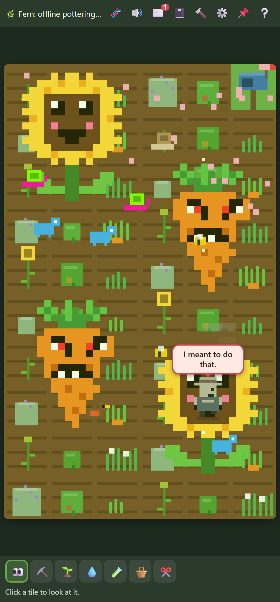
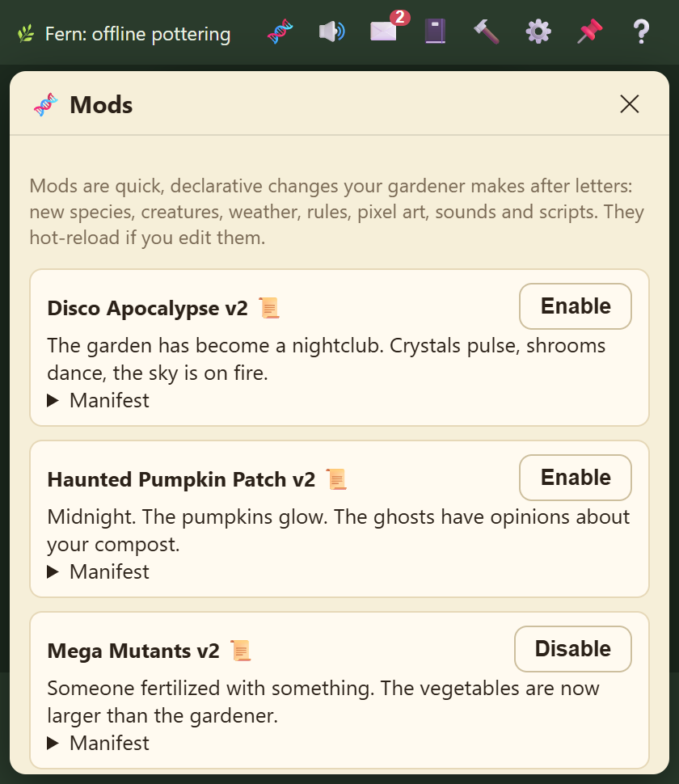

# 🌱 Agent Garden

**An idle gardening game that lives on the side of your screen, run by your own AI agent, who can
rewrite the game while you play it.**

<p align="center">
  
  &nbsp;
  
</p>

A tiny pixel gardener potters about, watering, harvesting and muttering in speech bubbles. You can
grab a trowel and help, or just leave a **letter in the mailbox**:

> *"Grow me something absolutely unhinged. Glowing. Loud. Possibly haunted."*

A couple of minutes after you go quiet, your letter goes to a real AI agent (Claude Code, Codex, or
any model you like). It decides what the gardener does next, writes a reply... and then
**changes the game itself**. It can add new plants, creatures, weather, pixel art, sound effects
and scripts. When that still isn't enough, it walks into the shed and **rewrites the game's source
code**.

No two gardens end up the same game.

## Highlights

<table>
  <tr>
    <td align="center" width="50%"></td>
    <td align="center" width="50%"></td>
  </tr>
  <tr>
    <td align="center"><b>"Make the pumpkins haunted. Not spooky. <i>HAUNTED.</i>"</b><br/>Your gardener takes requests literally.</td>
    <td align="center"><b>Snip the carrot it was about to water.</b><br/>Watch its plans wilt in real time.</td>
  </tr>
</table>

### One garden, four completely different games

<table>
  <tr>
    <td align="center" width="25%"></td>
    <td align="center" width="25%"></td>
    <td align="center" width="25%"></td>
    <td align="center" width="25%"></td>
  </tr>
  <tr>
    <td align="center"><b>Day 1.</b><br/>A perfectly normal garden.</td>
    <td align="center"><b>Disco Apocalypse.</b><br/>One letter later.</td>
    <td align="center"><b>Haunted Pumpkin Patch.</b><br/>The ghosts have opinions.</td>
    <td align="center"><b>Mega Mutants.</b><br/>Kevin has eaten a robin.</td>
  </tr>
</table>

Same game, same save. The only difference is what the gardener was asked for.

### Why it's fun

- **Your gardener has a personality, and it's yours to shape.** It chats, sulks, gets excited about
  mail, and remembers what you told it last week. Ignore it for half an hour and it starts to miss
  you, and says so.
- **Letters are cheat codes.** Ask for glowing moon carrots, a sprinkler robot, weather that rains
  petals, or a garden that's secretly a nightclub. The gardener invents it, draws the sprites,
  composes the sound effects and plants it.
- **You and the AI share the same garden.** Plant, water, harvest and cut alongside it. Messing with
  its plans is half the fun: if you cut down the carrot it was walking over to water, expect a comic
  fizzle (*"I have been betrayed by the soil."*).
- **It never stops.** The garden keeps growing while the tab is closed and catches up on time the
  server was off. Press 📌 and it floats on top of your other windows, a tiny living sidebar to your
  workday.
- **It can change the rules, not just the content.** New tools, new mechanics, a different UI, a
  rewritten renderer: the agent edits the real source, and you can read every diff.
- **Nothing it does can break your garden for good.** Every change is checked against your real save
  before it goes live, and you can revert any version with one click.

## Quick start

Requires **Node.js 24+** and **git** (for code rewrites). TypeScript runs natively; the only
packages are `typescript` and `@types/node`, used by the type-check gate.

```bash
npm install
```

```bash
npm start
```

Open http://localhost:4747 in Chrome or Edge, then press 📌 to float the garden as an
always-on-top bar (Document Picture-in-Picture). Other browsers get a compact popup window.

The garden starts with an **offline gardener** (no AI). Open ⚙️ Settings to pick an agent:

| Provider | What it uses | Setup |
| --- | --- | --- |
| Claude Code CLI | your `claude` login (Claude subscription or API key) | install Claude Code and sign in once |
| Codex CLI | your `codex` login (ChatGPT plan or API key) | install Codex and `codex login` |
| Anthropic API | Messages API | set `ANTHROPIC_API_KEY` before `npm start` |
| OpenAI-compatible | any `/v1/chat/completions` (OpenAI, OpenRouter, Ollama, LM Studio) | set base URL; optional `OPENAI_API_KEY` |
| Offline gardener | built-in rules, no AI | — |

Pick a model (e.g. `haiku` for Claude; leave it blank for Codex to use your Codex default, or pick
one from the list it discovers), press **Test connection**, then **Save**. Code rewrites need a
provider that can edit files: Claude Code CLI, Codex CLI, or the offline gardener (whose "rewrites"
are a small demo edit). Turn them off with *Let the gardener rewrite the garden's code*.
**Think now** forces a planning run instead of waiting for the debounce.

## Playing

A new garden is a bare lawn. On first launch you get a short welcome (reopen it with ❔), then
your gardener asks **"What kind of garden should I grow?"**. Your answer is posted as your first
letter and answered straight away.

- **Tools** (keys 1–7): look, till, plant (choose a seed), water, fertilize, harvest, cut.
- **Mailbox** ✉️ (or click the mailbox tile): write letters; read your gardener's replies.
- **Journal** 📓: the gardener's reasoning for every planning run — what it noticed, decided, remembered,
  which mods it touched, and any self-corrections it needed to make valid output.
- **Mods** 🧬: everything in `mods/`, with history. Toggle mods on/off; edit them by hand (hot reload).

  
- **The shed** 🔨: code-rewrite projects with their checks and diffs, every version of the world's
  code, *Revert to this*, and *Reset to original*. Your garden (the save) is kept across all of these.

The garden keeps growing while the browser is closed (the server simulates), and catches up on
time the server itself was off (up to 3 days).

---

# Under the hood

The interesting engineering problem: **how do you let an AI agent rewrite a running game without
the game being one bad edit away from death?** Agent Garden's answer is a hard split between a
small, stable **kernel** and an agent-owned **world**.

## A stable kernel, a rewritable world

```
 browser                                   kernel (Node 24, never edited by the agent)
 ┌───────────────────────────────┐  SSE  ┌────────────────────────────────────────────────┐
 │ kernel/web/shell.ts           │◀──────│ main.ts      HTTP API, SSE, wiring             │
 │  mailbox · journal · shed ·   │ JSON  │ ai/planner   context → agent → validate →      │
 │  settings · PiP               │──────▶│              repair → apply → journal          │
 │ ┌───────────────────────────┐ │       │ workshop     rewrite request → agent edits     │
 │ │ /world/<commit>/web/      │ │       │ gates        static · tsc · tests · soak       │
 │ │   client.ts  mount(host)  │ │       │ supervisor   live world, swap, probation,      │
 │ │   (rendering, tools, …)   │ │       │              crash restarts, rollback          │
 │ └───────────────────────────┘ │       │ world-repo   git: data/world/repo (+ staging)  │
 └───────────────────────────────┘       │ db.ts        SQLite                            │
                                         └───────────────┬────────────────────────────────┘
                                                IPC      │ fork --permission
                                         ┌───────────────▼────────────────────────────────┐
                                         │ world-host.ts → data/world/repo/src/index.ts    │
                                         │ the world: simulation, mods, agent sections,   │
                                         │ offline gardener (may only write mods/)        │
                                         └────────────────────────────────────────────────┘
```

**The kernel** (`kernel/`) is the part the agent never touches: persistence (SQLite), the HTTP
server and browser shell, the AI planning loop and providers, letters, memories, and the supervisor
that runs the world. It knows nothing about plants or carrots.

**The world** is everything that makes the game *the game*: the simulation, rules, entities,
rendering, input, sounds, panels, the mod system, and even the schema of the plans the agent itself
is allowed to make. On first run the template in `world/` is copied into `data/world/repo/`, a git
repository that belongs to your garden. From then on it's the agent's to change.

The two sides meet only through one versioned contract, `kernel/contract.ts` (copied read-only into
every world as `src/contract.ts`):

- The world exports `createWorld(init)` returning `tick`, `snapshot`, `publicState`, `content`, `rpc`,
  `notify`, and `agent.{sections, guide, context, validate, fallback, apply, offlinePlan}`.
- The world's browser code exports `mount(host)`. The shell hands it a stage, a toolbar, an overlay
  for panels and an `rpc` function, and the world draws whatever it likes there.

The kernel never inspects world state. It stores opaque `snapshot()`s and forwards streams, so a
rewritten world can change its save format, its UI or its whole game loop without the kernel
noticing.

## The agent gets a workspace: the shed

When a letter asks for something mods can't express, the planner can return a `rewrite` request.
The kernel then:

1. Creates a **detached git worktree** of the live world at `data/world/staging/`.
2. **Launches your agent CLI with that folder as its working directory**, and a brief on stdin:
   - Claude Code: `claude -p --permission-mode acceptEdits --output-format json`
   - Codex: `codex exec -s workspace-write ...`

   The brief explains the contract, the file tree, the rules, the gates it must pass, and a dump of
   the garden as it is right now.
3. Lets the agent work like it would on any codebase: read files, edit them, add tests, run them.
   Inside that folder it can change almost anything: the simulation, rules, entities, the canvas
   renderer, the toolbar, the panels, the sounds, the mod system, and the plan format it uses to
   drive the gardener. The only file it may not change is `src/contract.ts`, and the kernel
   restores it if it does.
4. Runs the **gates** on the result (below). If they fail, the output goes back to the agent for
   another round (default 3 rounds, 20 minutes each).
5. On a pass, commits, fast-forwards the live branch, snapshots your save, boots the new world and
   stops the old one. The browser remounts `/world/<commit>/web/client.ts` in place, so even the
   floating picture-in-picture window survives the swap.

Day-to-day planning uses the same CLIs in a read-only way: `claude -p` (or `codex exec -s read-only`)
runs in a scratch folder, `data/agent-work/`, and returns a JSON plan. The kernel validates each
section of that plan (the world validates its own sections over IPC) and re-asks only for the parts
that failed, with the errors attached.

## Nothing goes live unproven

| Gate | What it checks |
| --- | --- |
| **static** | the contract is untouched, entry points still exist, browser files strip cleanly to JS |
| **typecheck** | `tsc --noEmit` in strict mode |
| **tests** | the world's own `node:test` suite, run under the same sandbox as the live world |
| **soak** | loads **your real save** and a brand-new garden into a sandboxed process and simulates two game hours of each |

After a swap the new code is on **probation** (default 10 minutes). A crash or hang during
probation rolls back to the previous commit *and* the save taken just before the swap. Outside
probation, crashes restart the world, and 3 crashes in 5 minutes roll back to the newest known-good
commit. Every version is a git commit, and the 🔨 shed lets you read any diff, revert to it, or
reset to the original template. Your garden survives all of it.

## Two speeds of change

| | Mods (`mods/`) | Code rewrites (the shed) |
| --- | --- | --- |
| Written by | the planner, as part of a normal plan | the agent CLI, in a git worktree |
| Can change | species, creatures, weather, rules (within bounds), pixel-art sprites, synthesised sounds, sandboxed scripts | anything in the world |
| Goes live | instantly, hot-reloaded | after the gates pass, then on probation |
| Undo | toggle off in 🧬 | revert in 🔨 |

See [docs/MODDING.md](docs/MODDING.md) for the mod format. You can write mods by hand too.

## Isolation

The world runs as a child process under Node's `--permission` model. It can read its own folder and
the mods folder, write only the mods folder, and can't start child processes or workers. World tests
run under the same flags. Node 24 can't restrict network access, so the host deletes the
`fetch`/`WebSocket` globals as a speed bump only. The HTTP server binds to 127.0.0.1 and checks
`Host` and `Origin`. Mod scripts run in `node:vm` with a per-call time budget. That isn't a hard
sandbox, so only run mods you (or your own agent) wrote.

## Configuration

| Env var | Default | |
| --- | --- | --- |
| `PORT` | `4747` | HTTP port (bound to 127.0.0.1 only) |
| `GARDEN_DATA` | `./data` | SQLite database, the world's git repo (`data/world/repo`), agent scratch dir |
| `GARDEN_MODS` | `./mods` | mods folder |

## Development

```bash
npm test          # kernel + world tests (node:test)
npm run typecheck # tsc --noEmit
npm run dev       # restart on server changes
```

The template world lives in `world/`; each player's world is a git repo seeded from it on first run.

See [docs/ARCHITECTURE.md](docs/ARCHITECTURE.md), [docs/DESIGN-kernel-world.md](docs/DESIGN-kernel-world.md),
[docs/MODDING.md](docs/MODDING.md) and
[TASKS.md](TASKS.md) (the task tracker this project was built from).
